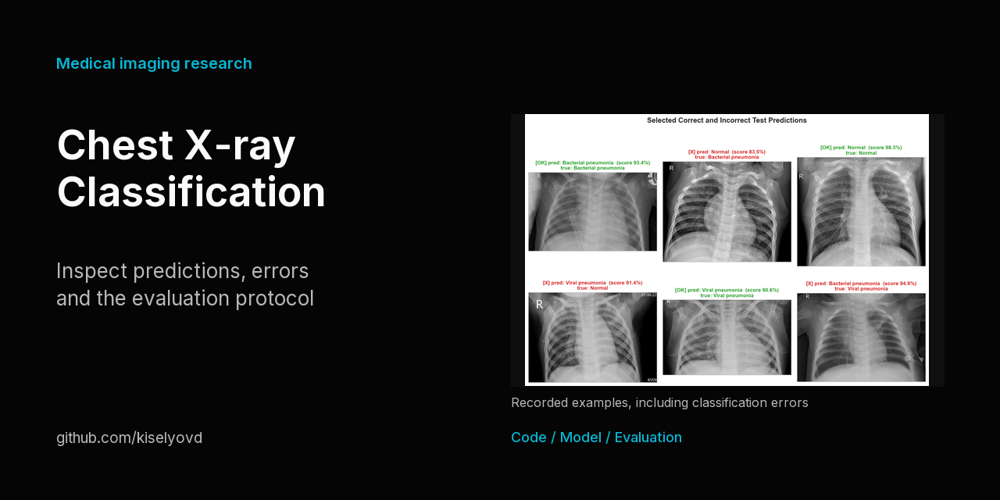

# Chest X-Ray Classification

A research classifier for normal, bacterial-pneumonia, and viral-pneumonia chest radiographs. ConvNeXt-V2-Tiny is the main model; a DINOv2 linear probe provides the comparison.

[](https://github.com/kiselyovd/chest-xray-classifier/actions/workflows/ci.yml) [](https://kiselyovd.github.io/chest-xray-classifier/) [](https://huggingface.co/kiselyovd/chest-xray-classifier) [](LICENSE)

[](https://kiselyovd.github.io/chest-xray-classifier/showcase/)

**[Explore the classification errors](https://kiselyovd.github.io/chest-xray-classifier/showcase/)** — change the model, read counts or row percentages, and inspect a true/predicted-class cell. The UI uses committed JSON reports; the labelled image gallery is separate from the test results.

<!-- ARTIFACT-OVERVIEW:START -->
Accuracy **91.35%** · Macro F1 **90.30%**. [Evaluation and scope](https://github.com/kiselyovd/chest-xray-classifier/blob/main/reports/replay-native-2026-10-15.json).

**Evidence:** Replayed on the original 624-image test fold. The complete confusion matrix and metrics reproduce the stored main report. Historical checkpoint training membership is unrecorded; the baseline remains a stored report.
<!-- ARTIFACT-OVERVIEW:END -->

## Results

<!-- ARTIFACT-MANIFEST:START -->
### Current artifact and evaluation

**Replayed on the original 624-image test fold**

| Metric | Value |
|---|---:|
| Accuracy | 91.35% |
| Macro F1 | 90.30% |
| Macro AUROC (OvR) | 97.53% |

The complete confusion matrix and metrics reproduce the stored main report. Historical checkpoint training membership is unrecorded; the baseline remains a stored report.

[Evaluation record](https://github.com/kiselyovd/chest-xray-classifier/blob/main/reports/replay-native-2026-10-15.json) · [Pinned model](https://huggingface.co/kiselyovd/chest-xray-classifier/tree/09bd78b58c657870961faa1b79699da5ca8bc796)
<!-- ARTIFACT-MANIFEST:END -->

[Replay details and file identities](docs/EVALUATION.md). The explorer also includes the [DINOv2 stored baseline report](reports/metrics_baseline.json); a matching baseline checkpoint is absent from this Hub snapshot.

## Try the published model

```python
import torch
from PIL import Image
from torchvision.transforms import v2
from transformers import AutoModelForImageClassification

REPO = "kiselyovd/chest-xray-classifier"
REVISION = "09bd78b58c657870961faa1b79699da5ca8bc796"
model = AutoModelForImageClassification.from_pretrained(
    REPO, revision=REVISION, use_safetensors=True, trust_remote_code=False
).eval()
transform = v2.Compose([
    v2.ToImage(), v2.Resize(255, antialias=True), v2.CenterCrop(224),
    v2.ToDtype(torch.float32, scale=True),
    v2.Normalize([0.485, 0.456, 0.406], [0.229, 0.224, 0.225]),
])
image = Image.open("chest-xray.jpeg").convert("RGB")
with torch.inference_mode():
    scores = model(pixel_values=transform(image).unsqueeze(0)).logits.softmax(-1)[0]
print([(model.config.id2label[i], float(scores[i])) for i in scores.argsort(descending=True).tolist()])
```

This recipe uses the production torchvision geometry. The corrected native processor preserves torchvision's rounded crop anchor; see the numerical parity receipts in the evaluation guide. [Training and local serving commands](docs/project-guide.md#quick-start) · [Русский README](README.ru.md)

## Documentation

- [Interactive report explorer](https://kiselyovd.github.io/chest-xray-classifier/showcase/)
- [Project guide](docs/project-guide.md): dataset, full recipes, inference, and Docker.
- [Architecture](docs/architecture.md) · [Training](docs/training.md) · [Serving](docs/serving.md)

## Intended use and terms

Research and education only. The model has not been clinically validated and is not a medical device. The benchmark uses a limited pediatric dataset.

Repository code is [MIT](LICENSE); dataset, pretrained models, and model artifacts retain their respective terms. See [component licenses and attribution](docs/LICENSES.md) and [CITATION.cff](CITATION.cff).
