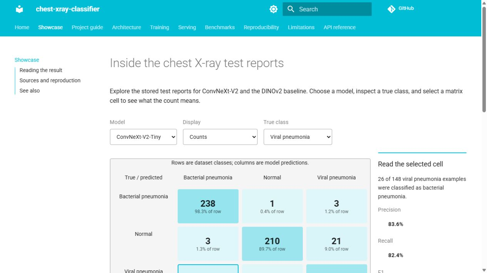
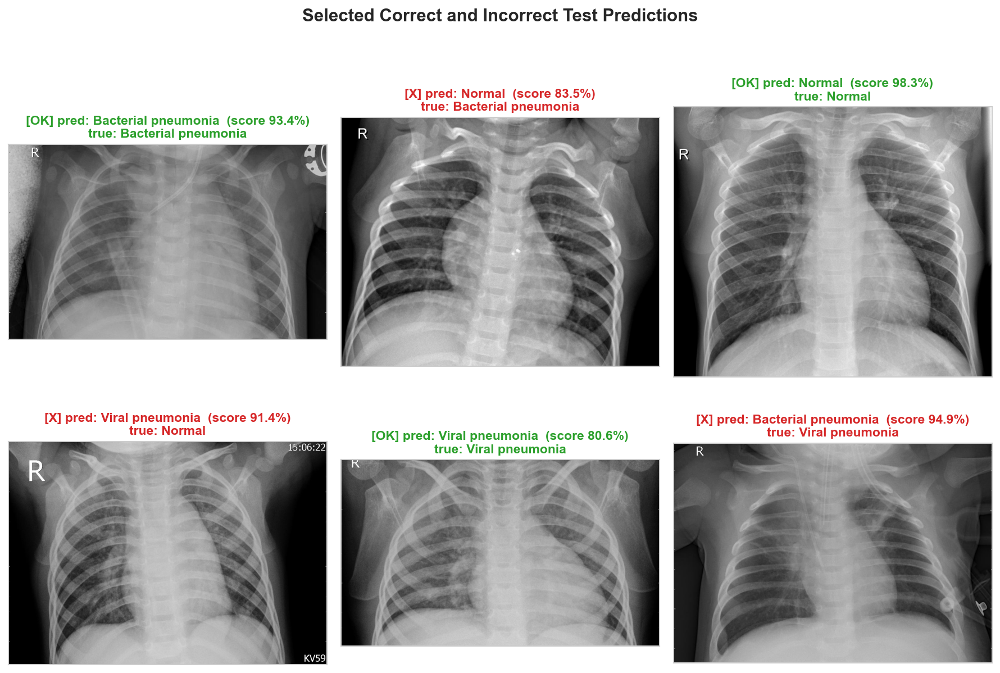

# Chest X-Ray Classification

Classify pediatric frontal radiographs as normal, bacterial pneumonia or viral pneumonia with ConvNeXt-V2-Tiny.

[Explore classification errors](showcase.md) · [Run the published model](https://github.com/kiselyovd/chest-xray-classifier#try-the-published-model) · [Model and weights](https://huggingface.co/kiselyovd/chest-xray-classifier)

## Results

<!-- ARTIFACT-MANIFEST:START -->
### Current artifact and evaluation

**Replayed on the original 624-image test fold**

| Metric | Value |
|---|---:|
| Accuracy | 91.35% |
| Macro F1 | 90.30% |
| Macro AUROC (OvR) | 97.53% |

The complete confusion matrix and metrics reproduce the stored main report. Historical checkpoint training membership is unrecorded; the baseline remains a stored report.

[Evaluation record](https://github.com/kiselyovd/chest-xray-classifier/blob/main/reports/replay-native-2026-10-15.json) · [Pinned model](https://huggingface.co/kiselyovd/chest-xray-classifier/tree/09bd78b58c657870961faa1b79699da5ca8bc796)
<!-- ARTIFACT-MANIFEST:END -->

The explorer retains the DINOv2 comparison as a stored report. The labelled image gallery is separate from benchmark results. [Replay and preprocessing contract](EVALUATION.md).

## Inspect real cases

The test-prediction panel selects a median-score correct case and a high-score error for every class when both are available. Scores are model outputs, not calibrated certainty.

## Protocol and reuse

The original Kaggle test fold contains 624 images. Filename-based pneumonia subtypes produce 242 bacterial, 234 normal and 148 viral labels. File hashes, model identity and prediction arrays accompany the replay. Historical checkpoint training membership and patient-level independence are not established by the old run records; clinical validation has not been performed.

[Evaluation contract](EVALUATION.md) · [Component licenses](LICENSES.md) · [Project guide](project-guide.md) · [Limitations](LIMITATIONS.md)
