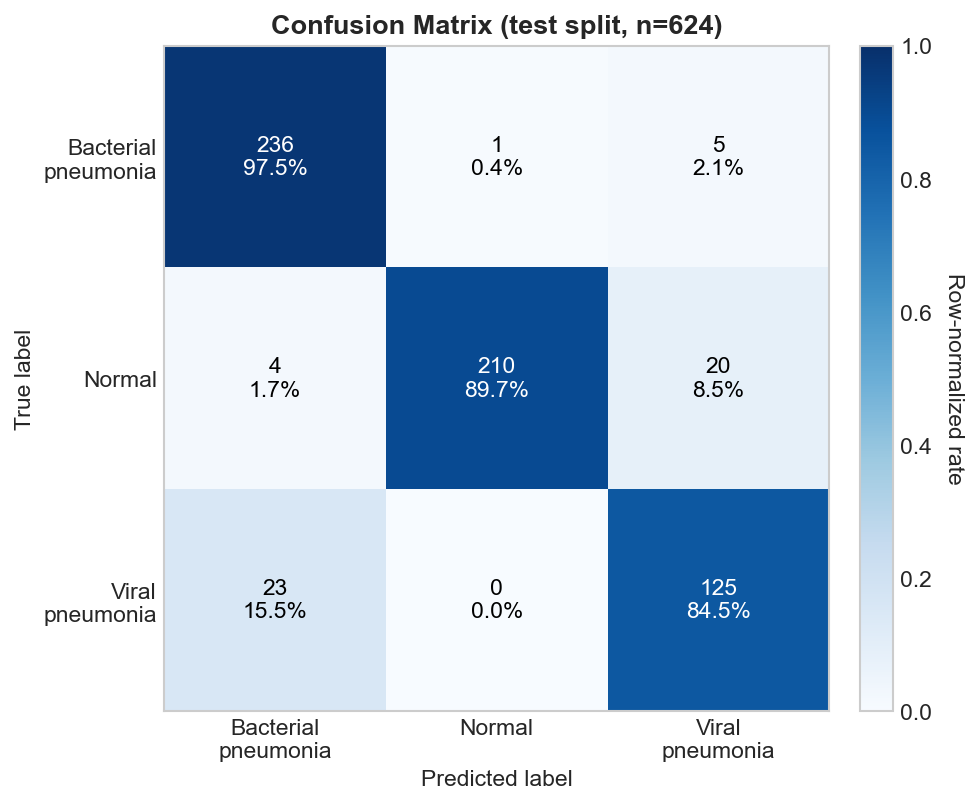

# Where the chest X-ray classifiers disagree

Explore the stored test reports for ConvNeXt-V2 and the DINOv2 baseline. Choose a model, inspect a true class, and select a matrix cell to see what the count means.

<section class="sc-explorer" data-showcase="matrix" data-owner="kiselyovd" aria-label="Where the chest X-ray classifiers disagree interactive showcase">
  

  

    <figure class="sc-stage"><figcaption>The main model's stored evaluation report.</figcaption></figure>
    <aside class="sc-details"><h3>Explore the example</h3>
Use the controls to inspect this project's published artifacts.
</aside>
  

  
The source example is available above; interactive controls load when JavaScript is enabled.

  

</section>

## Reading the result

Both reports use 624 test radiographs and the same three dataset classes. The main model records 54 classification errors; the baseline records 90. The matrix counts and per-class precision, recall, and F1 are read from committed JSON, rather than extracted from a chart.

The images in the gallery are committed smoke examples with dataset labels. They are separate from the aggregate test report; the stored reports do not include per-image predictions or scores for them.

This is a research and educational benchmark on pediatric chest radiographs. It is not clinical validation. [Evaluation protocol](REPRODUCIBILITY.md) and [limitations](LIMITATIONS.md).

## Sources and reproduction

The explorer uses published artifacts from [kiselyovd/chest-xray-classifier](https://github.com/kiselyovd/chest-xray-classifier). [Inspect the pinned source](https://github.com/kiselyovd/chest-xray-classifier/blob/e0badb62a91f48acb0cf37544605e492f23864d8/reports/metrics.json) and the [structured showcase data](assets/showcase/data.json).

UI state stays in the current page. Detailed diagnostic events can be enabled with `?debug=1`; they contain selected IDs and modes, not sample content.

## See also

- [Project overview](index.md)
- [Architecture](architecture.md)
- [Source repository](https://github.com/kiselyovd/chest-xray-classifier)
